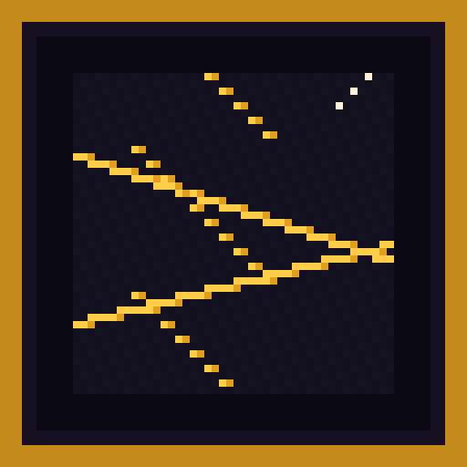

   

 

Break a Fortune Rift and something always happens. Every rift pays a guaranteed haul from a large loot table, then triggers one of 100 weighted events: loot, chaos, dungeons, merchants, and mythic encounters.

   

## Why FortuneRift?

- Every break pays. Traps and mobs still happen, and the loot still drops.
- One large guaranteed table plus rarity tables, so packs can retune rewards without a code change.
- Six rift variants, from the standard block to a mythic rift.
- One hundred weighted events across rewards, mobs, traps, structures, chaos, jackpots, minigames, NPCs, and secrets.
- A fortune meter that softens long unlucky streaks.
- Server-side rolls, cooldowns, and a config that can turn TNT, bosses, terrain edits, and mythic events off.
- Built for Fabric and NeoForge on Minecraft 26.3.

# Features

| Feature | Description |
| --- | --- |
| Guaranteed reward | Every activated rift rolls `fortunerift:guaranteed`. Blessed, cursed, ancient, and void rifts roll it twice. Mythic rifts roll it three times. |
| Big loot table | Supplies, gems, gear, music discs, and rare jackpot items in one table. Rarity tables still back specific events. |
| Fortune Rift | The standard block. Break it for a weighted event. |
| Blessed Rift | Leans toward helpful events and rolls the guaranteed table twice. |
| Cursed Rift | Leans toward danger, and still pays the guaranteed haul twice. |
| Ancient, Void, and Mythic Rifts | Stronger rolls. Mythic rifts only draw epic and mythic events. |
| 100 events | Diamond rain, vaults, merchants, hunts, the cataclysm, and quieter surprises. Secret events stay hidden in the journal until seen. |
| Fortune meter | Bad events raise fortune. Good events spend it. High fortune makes the next helpful event more likely. |
| Rift Journal | Lists what you have witnessed. Use the book and the list is sent in chat. |
| Commands | Give rifts, force an event, roll at random, reload config, list events, read and set fortune. |

***

# Screenshots

## Rift block
REPLACE_ME rift block in a cave

## Guaranteed loot
REPLACE_ME inventory after one break

## A mythic event
REPLACE_ME cataclysm or vault

# Default Keybindings

FortuneRift adds no keys. Break a rift, or use the journal item.

# Configuration

## `config/fortunerift.json`

- `riftGenerationEnabled` and `riftGenerationChance` control natural rifts.
- `fortuneSystemEnabled` toggles the pity meter.
- `eventRadius` is how far a nearby event reaches. Default 24.
- `allowStructureEvents`, `allowDestructiveEvents`, `allowTerrainModification`, `allowTNTEvents`, `allowBossEvents`, and `enableMythicEvents` shut whole categories off.
- `allowSilkTouch` lets a player-placed rift drop itself. Natural rifts never silk-touch.
- `globalEventCooldown`, `playerEventCooldown`, and `chunkEventLimit` slow farms.
- `rarityWeights` defaults to common 45, uncommon 28, rare 17, epic 8, mythic 2.

Reload with `/fortunerift reload`.

# Compatibility

- Minecraft 26.3
- Fabric and NeoForge jars in this repository
- Dedicated servers and singleplayer
- Safe to put in a modpack under the Apache-2.0 license
- Loot uses vanilla items only, so other mods' items can be added by editing the loot tables

# Frequently Asked Questions

## Does every rift give loot?
Yes. After a real activation, the guaranteed table always rolls. A trap or a mob is the event on top of that loot. Silk Touch on a natural rift still gives nothing. A player-placed rift drops as an item only when `allowSilkTouch` is true, and that pickup does not also roll loot.

## Can I turn off grief?
Yes. Disable TNT, bosses, terrain edits, destructive events, or structures in the config. Disabled events are skipped. The guaranteed loot still drops.

## Where are the rewards edited?
`data/fortunerift/loot_table/guaranteed.json` is the big table. `common`, `uncommon`, `rare`, `epic`, `mythic`, and `cataclysm` back individual events. A datapack can replace them.

# Roadmap

### Planned Features
- The same gameplay on Minecraft 1.21.1 and 1.20.1
- Natural world generation for the rift blocks
- A journal screen instead of the chat list

# Support Development

# Community & Support

- Discord: https://discord.gg/TJc3CxR4jK
- GitHub: https://github.com/MeherBenSalem/FortuneRift
- CurseForge: https://www.curseforge.com/members/nightbeamstudio/projects
- Modrinth: https://modrinth.com/organization/nightbeam
- Website: https://nightbeam.dev
- Store: https://nightbeam.dev/store
- Pro: https://nightbeam.dev/community

# License

FortuneRift is Apache-2.0. Modpacks may include the mod. Keep the license notice with redistributed copies.

## NightBeam Studio

_Explore more. Get lost less._

  

